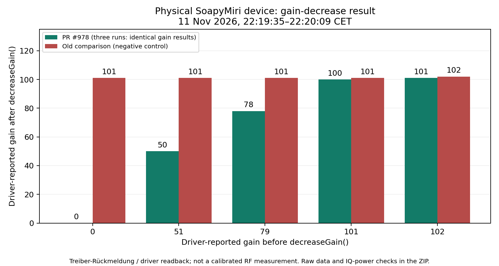

# SoapySDR gain-decrease hardware test

The production `CSoapySdr::decreaseGain()` implementation in
[PR #978](https://github.com/AlbrechtL/welle.io/pull/978) was exercised on a
physical SoapyMiri receiver on **11 November 2026, 22:19:35–22:20:09 CET**.
The tested revision was `880df75742b3e878645c901c9f5e2994b9a829fb`.

All **15 fixed checks passed**: five starting gains, repeated three times.
The negative control used the same source with only the comparison in
`decreaseGain()` reverted from `<` to `>`. All five control checks failed
the expected decrease, reproducing the defect.

| Gain before | Expected / fixed result (all three runs) | Old-comparison result |
| ---: | ---: | ---: |
| 0 | 0 | 101 |
| 51 | 50 | 101 |
| 79 | 78 | 101 |
| 101 | 100 | 101 |
| 102 | 101 | 102 |



## Setup and method

- ARM64 Raspberry Pi, Debian 13, Linux `6.18.50+rpt-rpi-v8`.
- Physical Miri device using the custom SoapyMiri/LibMiriSDR driver,
  SoapySDR `0.8.1-5+b2` (ABI 0.8); exact library hashes are in the evidence.
- Channel **7B**, **190.640 MHz**, sample rate **2.048 MS/s**, BULK transfers.
- Explicit device selection; a separate production receiver stayed running.

The harness compiles the actual production input implementation and accesses
its decrease method through the existing `TestSoapyGain` friend. Automatic
AGC is disabled for this direct test so that each decrease call is isolated.
For each starting gain, the harness sets the device gain, drains samples for
250 ms, reads the gain, and measures another 250 ms of IQ. It then calls the
production decrease method and repeats the settling/readback/measurement.
The expected value is independently calculated by a forward scan for the
greatest gain-table entry strictly below the reported starting gain.

Every measurement window contained more than 10,000 finite IQ samples and
nonzero mean power. For example, one fixed 79-to-78 step reduced mean IQ
power from `0.203897` to `0.156469`; the old-comparison 79-to-101 step increased
it from `0.205096` to `1.16165`.

## Evidence and reproduction

- [Download the complete evidence ZIP](assets/soapy-gain-20261111/hardware-evidence.zip)
- [All 20 cases as CSV](assets/soapy-gain-20261111/gain-results.csv)
- [Gain comparison image](assets/soapy-gain-20261111/gain-comparison.png)

The ZIP includes original stdout/stderr, timestamps, source and binary
checksums, environment details, the harness, the production source/header
subset, the exact negative-control patch, and build/run instructions.
`SHA256SUMS` covers every included file. The standalone rebuild recipe was
compiled successfully on the test Pi. Host-specific orchestration scripts
are audit material, not general installation instructions.

ZIP SHA-256:

```text
737c34f2cbd8396d0c6ba847cb59ad6e4c4f5f5dc58f6b64b61cf2b50a2ff6f0
```

## Interpretation limits

The gain values are **driver-reported state**, derived by LibMiriSDR from its
stored gain-stage settings. They are not independently measured RF gain or
hardware-register readback. IQ power is in driver units, not calibrated dBm.

This verifies the direction and boundary behavior of the production gain
step on this driver and device. It does not establish audio-quality gains,
complete automatic-AGC behavior, long-term stability, or results on other
drivers. The existing gain table stops at 101 although this driver advertises
102; this test records that behavior without changing the table.

An initial orchestration attempt aborted before any hardware case because
the normal receiver did not stop cleanly. It was restored, and the completed
run above used a corrected stop check. That aborted attempt contributes no
cases to the 15/15 result; its original and corrected workers are retained
in the ZIP for auditability.
