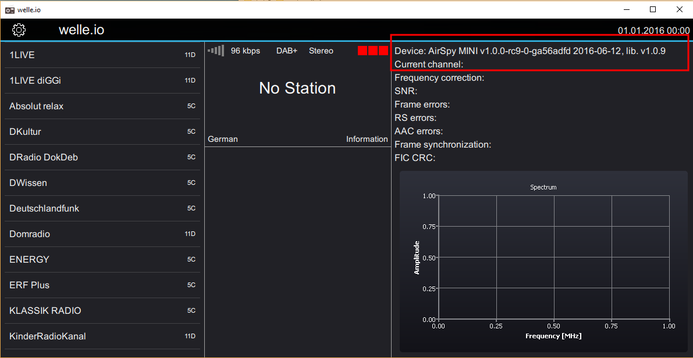

# Airspy

The [Airspy](https://airspy.com/) is a low cost, high performance SDR that
performs better than the well known rtl-sdr.

The following devices are supported:

* Airspy R2
* Airspy Mini

Not supported, because their bandwidth is too low:

* Airspy HF+
* Airspy HF+ Discovery

If you start welle.io without any options, welle.io detects the Airspy
automatically. After enabling the *Expert mode* you can check if welle.io
detected the device successfully.

