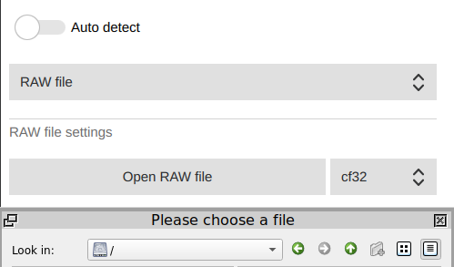
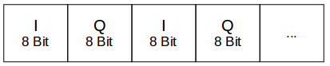
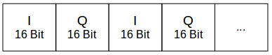

# Raw files

The raw file input is for developers who have recorded I/Q sample files. You
can use it to analyse your recordings or to test welle.io.

Open the settings, disable *Auto detect* and select *Open RAW file*. Select
the sample format of the file, e.g. `u8` for the output of `rtl_sdr` or
`cf32` for the File Sink of GNU Radio.



From the command line, `welle-io --raw-file <file> --raw-format <format>`
opens a file directly.

## File formats

All formats use a sample rate of 2048000 samples/s. Possible values of
`--raw-format`: `auto`, `u8`, `s8`, `s16le`, `s16be` and `cf32`. With `auto`
(the default) the format is taken from the end of the file name, e.g.
`recording.s16le.iq`; other files are read as `u8`.

### u8: 8 bit unsigned

The I/Q samples are 8-bit unsigned values in the following order:



* Size: 8-bit unsigned per I and Q sample
* Sources: rtl_sdr, rtl_tcp, qt-dab (`*.raw`)

### s8: 8 bit signed

Like u8, but with 8-bit signed values.

* Size: 8-bit signed per I and Q sample
* Source: odr-dabmod

### s16le: 16 bit signed little endian

The I/Q samples are 16-bit signed little endian values in the following
order:



* Size: 16-bit signed little endian per I and Q sample
* Source: qt-dab (`*.sdr`)

`s16be` is the same with big endian values.

### cf32: 32 bit float

The I/Q samples are 32-bit float values (complex float), as written by the
File Sink of GNU Radio.

## Recording a raw file

### rtl_sdr (format u8)

You can use the command line tool `rtl_sdr` to record a file with an rtl-sdr
device:

```sh
rtl_sdr -f <frequency> -s 2048000 -n <sample count> <file>
# e.g.
rtl_sdr -f 174928000 -s 2048000 -n 10000 yourfile.iq
```

The script [dab_raw_record.sh](../download/dab_raw_record.sh) is more
convenient. This command records 10 s of channel 5C into a file named
`<date and time>_5C.iq`:

```sh
dab_raw_record.sh -c 5C -t 10
```

### odr-dabmod (format s8)

To test your [Opendigitalradio](https://www.opendigitalradio.org/)
broadcasting set-up without broadcast hardware, you can create an I/Q file.
Use `odr-dabmod` with this [INI file](../download/DabMod.ini):

```sh
odr-dabmod DabMod.ini
```

The input file has to be `DabMux.eti`, the output file is `DabMod.iq`.

### Other tools

You can also use the following tools to record a raw file:

* [Qt-DAB](https://github.com/JvanKatwijk/qt-dab)
* [QIRX](https://qirx.softsyst.com/)
* [SDR#](https://airspy.com/)
