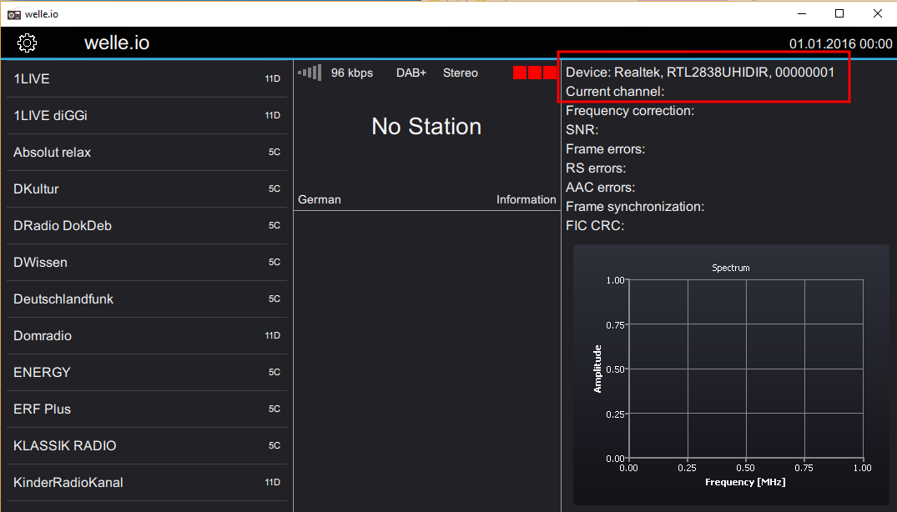
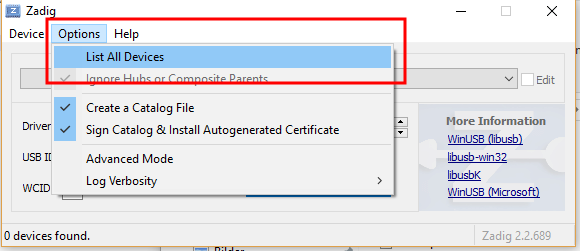
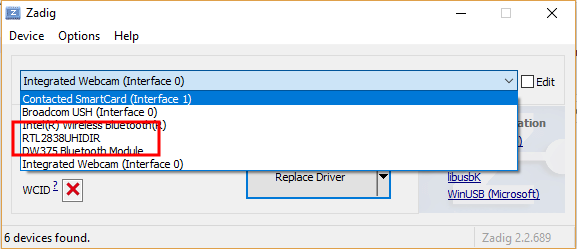
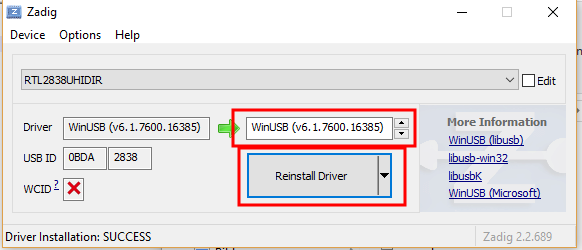
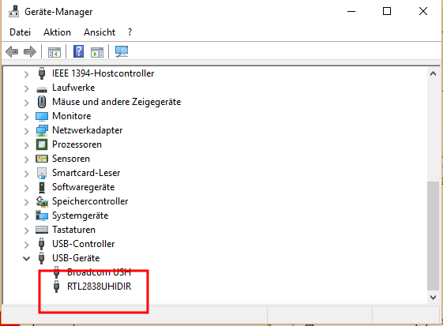

# rtl-sdr

The [rtl-sdr](https://osmocom.org/projects/rtl-sdr/wiki) is a DVB-T USB
dongle based on the Realtek RTL2832U.

## Supported hardware

Basically all rtl-sdr sticks with the Realtek chipset RTL2832U are
supported. They are sold under many different names.

## General

If you start welle.io without any options, welle.io detects the rtl-sdr
automatically. After enabling the *Expert mode* you can check if welle.io
detected the device successfully.



## Windows set up

To install the rtl-sdr driver on Windows:

* Navigate to your welle.io install folder, e.g. `C:\Program Files\welle.io`
* Run Zadig (`zadig-<version>.exe`)
* Choose *Options* and click *List All Devices*

    

* Select your rtl-sdr, e.g. "RTL2838UHIDIR"

    

* Make sure that "WinUSB (...)" is selected and click *Reinstall Driver* or
  *Replace Driver*

    

* Now you can check if your device is listed in the device manager

    

* Run welle.io

## Linux set up

Install the library librtlsdr. On Debian and Ubuntu:

```sh
sudo apt install librtlsdr0
```

The Flatpak version already contains it.
