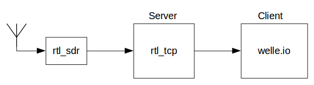
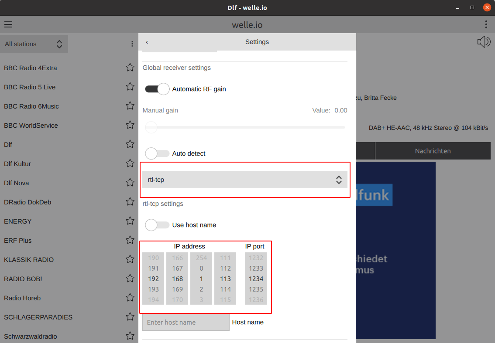

# rtl_tcp

The rtl_tcp input is for advanced users who run the tool
[rtl_tcp](https://osmocom.org/projects/rtl-sdr/wiki#rtl_tcp) on a server.

The sample rate is 2048000 samples/s. Each sample consists of an 8-bit I and
an 8-bit Q part, so the data rate is 32.768 Mbit/s (4.096 MB/s). Please make
sure that your network can transport this data rate without interruptions.

## Set up

Open the settings, disable *Auto detect* and select *rtl-tcp*. Then enter
the IP address or the host name and the port of the server.

welle-cli selects rtl_tcp with `-F rtl_tcp,<host>:<port>`, see
[welle-cli](../user-guide/welle-cli.md#driver-options).

## Hint

To start rtl_tcp as a daemon you can use this init.d script:
[rtl_tcp-server](../download/rtl_tcp-server). It starts rtl_tcp listening on
all network interfaces on port 1235.
