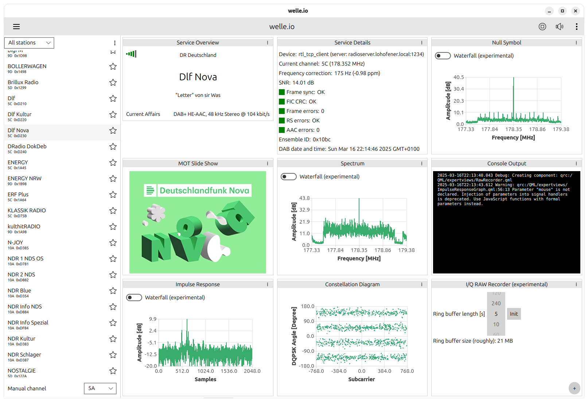

<div class="wio-home" markdown>

## Features

<p class="wio-lead">Listen to digital radio on your computer with a cheap
USB stick. welle.io decodes everything itself, it doesn't need an internet
connection.</p>

<div class="grid cards" markdown>

-   :material-radio-tower:{ .lg .middle } **DAB and DAB+**

    ---

    Plays DAB (MPEG Audio Layer II) and DAB+ (HE-AAC) stations, with a
    channel scan, favourites and station lists.

-   :material-image-text:{ .lg .middle } **Slideshow and radio text**

    ---

    Shows the slideshow (MOT), the radio text (dynamic label) and the
    programme type of the station.

-   :material-image-multiple:{ .lg .middle } **Station logos**

    ---

    Receives the station logos over DAB from the Service and Programme
    Information (SPI) of the ensemble.

-   :material-gesture-tap:{ .lg .middle } **Made for touch screens**

    ---

    Touch-friendly user interface for high-DPI and small screens, from
    desktops to phones and 7" displays.

-   :material-raspberry-pi:{ .lg .middle } **Runs on small computers**

    ---

    Fast enough for low-power devices such as the Raspberry Pi 2 and newer.

-   :material-chart-bell-curve:{ .lg .middle } **Expert mode**

    ---

    Spectrum, constellation, channel impulse response, TII and a lot of
    technical data about the ensemble and the signal.

-   :material-console:{ .lg .middle } **welle-cli**

    ---

    Command line tool with a web interface that decodes a whole ensemble
    and streams it to your browser.

    [:octicons-arrow-right-24: welle-cli](user-guide/welle-cli.md)

-   :material-access-point-network:{ .lg .middle } **Many SDR devices**

    ---

    rtl-sdr sticks, Airspy, rtl_tcp over the network and everything
    SoapySDR supports.

    [:octicons-arrow-right-24: Supported hardware](#supported-hardware)

-   :material-open-source-initiative:{ .lg .middle } **Open source**

    ---

    Free software under the GNU GPL v2 or later, developed on GitHub.

    [:octicons-arrow-right-24: Source code](https://github.com/AlbrechtL/welle.io)

</div>

## Expert mode

<p class="wio-lead">For the curious: everything about the signal and the
ensemble at a glance.</p>

<figure class="wio-screenshot" markdown>
{ loading=lazy }
</figure>

Watch welle.io in action in the [demo video on YouTube](https://youtu.be/IJcgdmud-AI).

## Download { #download }

=== ":fontawesome-brands-windows: Windows"

    Download the installer of the latest release from
    [GitHub releases](https://github.com/AlbrechtL/welle.io/releases).
    Windows 11 is supported. If you use an rtl-sdr stick, install its
    driver first, see [rtl-sdr](devices/rtl_sdr.md#windows-set-up).

=== ":fontawesome-brands-linux: Linux"

    The **Flatpak** from Flathub is recommended, because the packages of
    the Linux distributions can be outdated.

    [:material-package-down: Get it on Flathub](https://flathub.org/apps/io.welle.welle-gui){ .md-button .md-button--primary }

    Debian, Ubuntu 19.04 and newer:

    ```sh
    sudo apt install welle.io
    ```

    Fedora 35 and newer, from the [RPM Fusion](https://rpmfusion.org) sources:

    ```sh
    sudo dnf install --refresh welle-io
    ```

    See all [Linux distributions with welle.io](https://repology.org/project/welle.io/versions).

=== ":fontawesome-brands-apple: macOS"

    The current version builds on Apple Silicon and Intel Macs, see
    [Building](development/building.md#macos). Packages:

    - [Nightly builds](https://welle-io-nightlies.albrechtloh.de/)
    - MacPorts: `sudo port install welle.io`
    - [Legacy 2.4 installer](https://github.com/AlbrechtL/welle.io/releases/tag/v2.4) (Intel only)

=== ":fontawesome-brands-freebsd: FreeBSD"

    ```sh
    pkg install welle.io
    ```

    FreeBSD isn't maintained by the welle.io developers at the moment.

=== ":material-flask-outline: Nightly builds"

    Try the latest development version for Windows, Linux and macOS:
    [welle.io nightly builds](https://welle-io-nightlies.albrechtloh.de/).

    !!! warning
        Nightly builds are created automatically and are untested.

More details in the [installation guide](user-guide/installation.md).

## Supported hardware

<div class="grid cards" markdown>

-   :material-usb-flash-drive:{ .lg .middle } **[rtl-sdr](devices/rtl_sdr.md)**

    ---

    Cheap DVB-T USB sticks with the Realtek RTL2832U.

-   :material-access-point:{ .lg .middle } **[Airspy](devices/airspy.md)**

    ---

    Airspy R2 and Airspy Mini.

-   :material-lan:{ .lg .middle } **[rtl_tcp](devices/rtl_tcp.md)**

    ---

    An rtl-sdr stick on another computer in your network.

-   :material-tune-variant:{ .lg .middle } **[SoapySDR](devices/soapysdr.md)**

    ---

    LimeSDR, HackRF, USRP and many more through SoapySDR.

-   :material-file-music-outline:{ .lg .middle } **[Raw files](devices/rawfile.md)**

    ---

    Play back recorded I/Q samples, e.g. to test and analyse.

</div>

## Help and support

<div class="grid cards" markdown>

-   :material-book-open-variant:{ .lg .middle } **Documentation**

    ---

    Installation, usage, hardware set-up and the [FAQ](faq.md).

    [:octicons-arrow-right-24: User guide](user-guide/index.md)

-   :material-bug-outline:{ .lg .middle } **Found a problem?**

    ---

    Ask a question or report a bug in the issue tracker on GitHub.

    [:octicons-arrow-right-24: Issues](https://github.com/AlbrechtL/welle.io/issues)

-   :material-source-pull:{ .lg .middle } **Contribute**

    ---

    Pull requests, translations and new ideas are welcome.

    [:octicons-arrow-right-24: Development](development/index.md)

</div>

</div>
